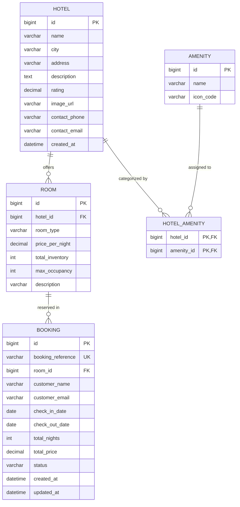

# 🏛️ Architectural Design & Engineering Specification (DESIGN.md)

## 1. Architectural Philosophy & Layered Model

The **Thomas Cook Hotel Booking Portal** implements a clean, layered multi-tier architecture following Domain-Driven Design (DDD) principles:

```
┌────────────────────────────────────────────────────────┐
│                   Angular 19 SPA                       │
│  Components (Standalone) ──► Services (RxJS Signals)   │
└───────────────────────────┬────────────────────────────┘
                            │ HTTP JSON / REST
┌───────────────────────────▼────────────────────────────┐
│              Presentation Layer (Spring Web)           │
│  - HotelController / BookingController                │
│  - Jakarta Bean Validation (@Valid, @NotNull, @Email)  │
│  - GlobalExceptionHandler (@RestControllerAdvice)      │
└───────────────────────────┬────────────────────────────┘
                            │
┌───────────────────────────▼────────────────────────────┐
│              Service Layer (Business Logic)            │
│  - HotelService (Search, Details, Comparison Engine)   │
│  - BookingService (Price Math, Locking, Reference Gen) │
└───────────────────────────┬────────────────────────────┘
                            │
┌───────────────────────────▼────────────────────────────┐
│              Data Access Layer (Spring Data JPA)       │
│  - Pessimistic Locking Query (@Lock PESSIMISTIC_WRITE) │
│  - Date-Overlap JPQL Query                             │
│  - Repositories: Hotel, Room, Booking, Amenity         │
└───────────────────────────┬────────────────────────────┘
                            │ JDBC
┌───────────────────────────▼────────────────────────────┐
│                  Database (MySQL 8.0)                  │
│  - Relational Schema with Foreign Keys & Unique Indexes│
└────────────────────────────────────────────────────────┘
```

---

## 2. Entity-Relationship Model (ERD)



---

## 3. Concurrency Control & Inventory Safety (Req 11 & 12)

### 3.1 The Race Condition Threat
In a naive booking implementation, if Room #101 has 1 available unit and two users submit reservations simultaneously:
1. Thread A queries `count = 0` (1 available).
2. Thread B queries `count = 0` (1 available).
3. Thread A inserts a booking.
4. Thread B inserts a booking.
5. **Result**: 2 bookings for 1 physical room (Double Booking / Overbooking!).

### 3.2 The Solution: Row-Level Pessimistic Locking
We employ **Pessimistic Write Locking** (`LockModeType.PESSIMISTIC_WRITE`) at the database row level:

```java
@Lock(LockModeType.PESSIMISTIC_WRITE)
@Query("SELECT r FROM Room r WHERE r.id = :id")
Optional<Room> findByIdWithPessimisticLock(@Param("id") Long id);
```

When `BookingService.createBooking` runs:
1. It opens a transaction (`@Transactional(isolation = Isolation.READ_COMMITTED)`).
2. It fetches the `Room` row using `SELECT ... FOR UPDATE`.
3. In MySQL (InnoDB), this places an **exclusive X-lock** on the specific room record.
4. Any competing transaction on the same room record is blocked until the first transaction finishes.
5. Inside the lock, the active overlapping bookings count is evaluated:
   ```sql
   SELECT COUNT(b) FROM Booking b 
   WHERE b.room.id = :roomId 
     AND b.status = 'CONFIRMED'
     AND b.checkInDate < :requestedCheckOut 
     AND b.checkOutDate > :requestedCheckIn
   ```
6. If `count >= room.totalInventory`, the transaction aborts and throws `RoomUnavailableException` (HTTP 409 Conflict).
7. If inventory is available, the booking is saved, the transaction commits, and the lock is cleanly released.

### 3.3 Automatic Restoration upon Cancellation
- Bookings maintain a status: `CONFIRMED` or `CANCELLED`.
- Because availability queries strictly include `b.status = 'CONFIRMED'`, cancelled bookings automatically drop out of the overlap count.
- This guarantees zero manual inventory counter drift, eliminating sync bugs.

---

## 4. Surprise Feature Design: Hotel Comparison Engine

### 4.1 Requirements
Allow travelers to select up to 3 hotels and review them in a side-by-side comparison matrix based on **price**, **location**, and **amenities**.

### 4.2 Frontend Architecture
- **`ComparisonService`**: An Angular reactive service backed by `BehaviorSubject<HotelSummary[]>`.
  - Ensures a maximum of 3 hotels can be selected at any time.
  - Exposes `isSelected(id)` and `toggleHotel(hotel)`.
- **`ComparisonDrawerComponent`**: A floating bottom dock pinned to the viewport, giving visual feedback with hotel thumbnails, prices, and an instant "Compare Now" trigger.
- **`ComparisonModalComponent`**:
  - Fetches the comparison matrix from `/api/v1/hotels/compare?hotelIds=1,2,3`.
  - Displays side-by-side columns:
    - **Price per Night**: Evaluates the minimum starting price and flags the cheapest option with a "Best Value" badge.
    - **Star Rating & Visual Stars**: Displays ratings and filled star icons.
    - **Location**: Compares city and physical address.
    - **Amenities Matrix**: Side-by-side checklist with checkmark (✓) or cross (✗) icons for all 8 standard luxury amenities (Wi-Fi, Pool, Spa, Breakfast, Gym, Shuttle, Room Service, Parking).
    - **Action**: Direct "Book Hotel" button routing into the detail page.

---

## 5. Security & Data Integrity Considerations

1. **Server-Side Price Authority**:
   - The frontend never passes `totalPrice` to the API. Total cost is computed on the backend as `nights * room.pricePerNight`.
2. **DTO Isolation**:
   - Database entities (`Hotel`, `Room`, `Booking`) are decoupled from REST responses via dedicated DTOs (`HotelSummaryDTO`, `HotelDetailDTO`, `BookingResponseDTO`).
3. **Audit Trails**:
   - Automatic database timestamps (`created_at`, `updated_at`) record exact lifecycle events for reservations.
4. **Input Validation**:
   - Jakarta Bean Validation enforces email formatting (`@Email`), non-empty strings (`@NotBlank`), and date logic (`@FutureOrPresent`, `@Future`).
