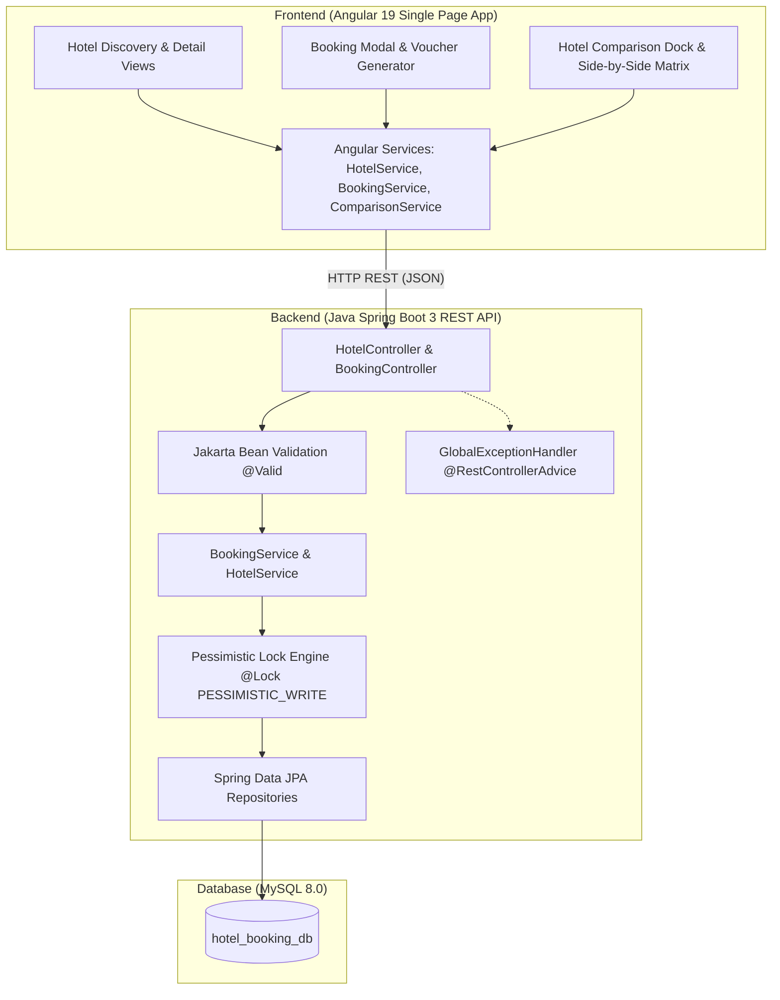

# 🏨 Thomas Cook — Luxury Hotel Booking Portal

> **Full-Stack Developer Internship Assessment Project**  
> Engineered with **Angular 19**, **Java Spring Boot 3**, and **MySQL 8.0**.  
> Features thread-safe pessimistic locking for simultaneous booking prevention, instant inventory restoration upon cancellation, and a side-by-side **Hotel Comparison** surprise feature.

---

## 🌟 Key Highlights & Assessment Requirements Coverage

| Requirement | Implementation Detail | Status |
|---|---|:---:|
| **1. At least 5 sample hotels** | 6 premier global hotels pre-loaded (London, Paris, Dubai, Tokyo, Zurich, New York) with high-res photography, star ratings, and detailed descriptions. | ✅ |
| **2. Search by location** | Case-insensitive city search (`/api/v1/hotels?city=...`) with one-click popular destination chips. | ✅ |
| **3. Select check-in & check-out dates** | Interactive date pickers with calendar validation enforcing check-out after check-in and forbidding past dates. | ✅ |
| **4. Display details & room availability** | Real-time date-overlap availability query dynamically displaying remaining room counts and low-inventory warnings. | ✅ |
| **5. Book room with name and email** | Clean reservation modal with form validation (`@NotBlank`, `@Email`, `@Size`), live stay summary, and instant confirmation. | ✅ |
| **6. Backend price calculation** | Server calculates `nights * pricePerNight` securely in Java to prevent client-side price tampering. | ✅ |
| **7. Unique booking reference** | High-entropy alphanumeric booking code generated on backend (`TC-BK-XXXXXX`) with database unique constraint. | ✅ |
| **8. Retrieve bookings** | Query by booking reference + customer email (`/api/v1/bookings/lookup`) displaying full booking voucher. | ✅ |
| **9. Allow cancellation** | One-click verified cancellation updating status to `CANCELLED` with audit timestamps. | ✅ |
| **10. Restore room availability** | Availability queries strictly filter on `status = 'CONFIRMED'`. Cancelling instantly returns the room to available inventory. | ✅ |
| **11. Prevent overbooking & validate dates** | Strict date validation (`checkIn >= today`, `checkOut > checkIn`) and capacity checks rejecting requests when inventory is exhausted. | ✅ |
| **12. Safe simultaneous booking handling** | Thread-safe `@Transactional(isolation = Isolation.READ_COMMITTED)` + **Pessimistic Write Lock** (`SELECT ... FOR UPDATE`) on the `Room` entity row. | ✅ |
| **Surprise Feature: Hotel Comparison** | Interactive floating comparison tray and full modal matrix comparing up to 3 hotels across price, location, ratings, room types, and amenities. | ✅ |

---

## 🏛️ System Architecture



---

## ⚡ Concurrency & Race Condition Handling Strategy

When two travelers attempt to book the last remaining room at the exact same millisecond:

```
User A (Millisecond 0) ──► Begins Transaction ──► Acquires PESSIMISTIC_WRITE Lock on Room #101
User B (Millisecond 0) ──► Begins Transaction ──► Waits for Room #101 Lock to Release...
                               │
User A: Reads inventory: 1 available ──► Inserts Booking ──► Commits ──► Releases Lock
                               │
User B: Acquires Lock ──► Reads inventory: 0 available ──► Throws RoomUnavailableException (HTTP 409 Conflict)
```

1. **Pessimistic Write Locking**:
   - In Spring Data JPA, `RoomRepository.findByIdWithPessimisticLock(Long id)` executes `SELECT * FROM rooms WHERE id = ? FOR UPDATE`.
   - MySQL blocks any concurrent transaction attempting to read or lock the same row until the first transaction completes.
2. **Date Overlap Mathematics**:
   - An existing reservation clashes if and only if:
     $$\text{Existing Check-In} < \text{Requested Check-Out} \quad \text{AND} \quad \text{Existing Check-Out} > \text{Requested Check-In}$$
3. **Zero Counter Drift**:
   - Rather than storing a mutable "counter" that can drift out of sync during crashes, availability is evaluated dynamically:
     $$\text{Available Rooms} = \text{room.totalInventory} - \text{COUNT}(\text{overlapping active bookings})$$
   - Cancellation simply changes status to `CANCELLED`. The room is immediately and safely available again.

---

## 🚀 Quick Start Guide

### Prerequisites
- **Java**: JDK 17, 21, or 25
- **Node.js**: v18+ or v20+ (Node 24 supported)
- **Database**: MySQL Server 8.0+ running on port `3306`

---

### Step 1: Initialize Database
Open MySQL Workbench, MySQL CLI, or your preferred SQL editor:
```sql
CREATE DATABASE IF NOT EXISTS hotel_booking_db CHARACTER SET utf8mb4 COLLATE utf8mb4_unicode_ci;
```

Load the schema and seed data:
```bash
# From the project root:
mysql -u root -p hotel_booking_db < database/schema.sql
mysql -u root -p hotel_booking_db < database/data.sql
```
*(Default credentials in `backend/src/main/resources/application.properties` are `root` / `root`. Update if your local MySQL password differs).*

---

### Step 2: Start the Java Spring Boot Backend
```bash
cd backend
# Run using the included Maven Wrapper:
mvn test-compile
mvn spring-boot:run
```
The REST API will launch on **`http://localhost:8080`**.

---

### Step 3: Start the Angular Frontend
```bash
cd frontend
npm install
npm start
```
The portal will launch on **`http://localhost:4200`**.

---

## 🧪 Running Automated Tests

A comprehensive test suite of **18 unit and integration tests** is included using **JUnit 5** and **Mockito**:

```bash
cd backend
mvn test
```

### Test Coverage Highlights:
- **`BookingServiceTest`**:
  - `shouldSuccessfullyCreateBooking()`: Server-side pricing (`nights * rate`) and reference code generation.
  - `shouldRejectBookingWhenCheckOutIsBeforeCheckIn()`: Date validation.
  - `shouldRejectBookingWhenCheckInIsInPast()`: Past date restriction.
  - `shouldThrowRoomUnavailableExceptionWhenInventoryIsExhausted()`: Overbooking rejection.
  - `shouldRetrieveBookingSuccessfully()`: Case-insensitive email lookup.
  - `shouldCancelBookingSuccessfully()`: Status updated to `CANCELLED`.
  - `shouldRejectCancellationWhenAlreadyCancelled()`: Prevents duplicate cancellation.
- **`HotelServiceTest`**:
  - `shouldSearchHotelsByCity()`: Filtering by destination.
  - `shouldCalculateAvailableRoomsForDateRange()`: Live availability computation.
  - `shouldLimitComparisonToMaxThreeHotels()`: Surprise feature bounds check.
- **`BookingControllerTest`**:
  - MockMvc HTTP tests verifying status codes (`201 Created`, `400 Bad Request`, `404 Not Found`, `409 Conflict`).

---

## 📡 REST API Reference

| Method | Endpoint | Query / Body Params | Response Description |
|---|---|---|---|
| `GET` | `/api/v1/hotels` | `?city=London&checkIn=2026-12-01&checkOut=2026-12-04` | List of hotel summaries matching destination. |
| `GET` | `/api/v1/hotels/{id}` | Path: `id`, Query: `checkIn`, `checkOut` | Full hotel profile with rooms and live availability badges. |
| `GET` | `/api/v1/hotels/compare` | `?hotelIds=1,2,3` | **Surprise Feature**: Side-by-side comparison data for up to 3 hotels. |
| `POST` | `/api/v1/bookings` | JSON: `CreateBookingRequest` | Reserves room, returns booking reference and price breakdown (`201 Created`). |
| `GET` | `/api/v1/bookings/lookup` | `?reference=TC-BK-100201&email=john.doe@thomascook.com` | Retrieves reservation voucher details. |
| `POST` | `/api/v1/bookings/{ref}/cancel`| JSON: `{ "customerEmail": "john.doe@thomascook.com" }` | Cancels reservation and restores room inventory. |

---

## 👥 Demo Walkthrough & Sample Data

For quick evaluation, sample bookings are pre-seeded in the database:

1. **London Booking**:
   - Reference: `TC-BK-100201`
   - Email: `john.doe@thomascook.com`
2. **Paris Booking**:
   - Reference: `TC-BK-100202`
   - Email: `emma.watson@paris.com`

Try looking them up under the **"My Bookings"** tab to test retrieval, voucher printing, and live cancellation!
